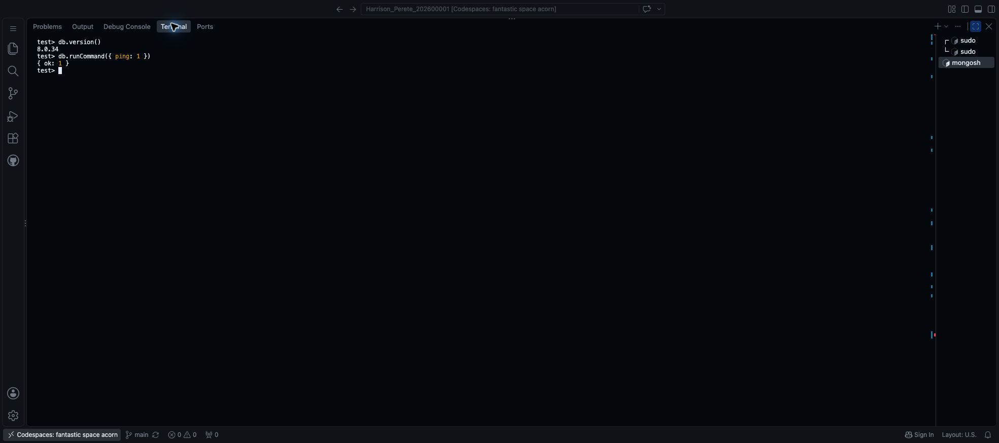

# MongoDB setup

## Environment

MongoDB Community Server 8.0.34 and mongosh 2.13.0 run directly in the existing Ubuntu 24.04.5 x86-64 Codespace. PostgreSQL remains separate. MongoDB's working files are in /workspaces/mongodb-data, outside the Git repository.

## Installation

The [source file](Harrison_Perete_202600001_P4_MongoDBSource.list) identifies MongoDB's official Ubuntu 24.04 package repository. The signing key verifies packages from that source.

```bash
sudo apt-get update
sudo apt-get install -y gnupg curl
curl -fsSL --connect-timeout 10 --max-time 30 https://pgp.mongodb.com/server-8.0.asc -o /tmp/mongodb-server-8.0.asc
sudo gpg --dearmor --yes --output /usr/share/keyrings/mongodb-server-8.0.gpg /tmp/mongodb-server-8.0.asc
sudo install -m 644 portfolio-4-nosql/Harrison_Perete_202600001_P4_MongoDBSource.list /etc/apt/sources.list.d/mongodb-org-8.0.list
sudo apt-get update
sudo apt-get install -y mongodb-org-server mongodb-mongosh
```

## Start and connect

```bash
mkdir -p /workspaces/mongodb-data
mongod --dbpath /workspaces/mongodb-data --logpath /workspaces/mongodb-data/mongod.log --logappend --bind_ip 127.0.0.1 --fork
mongosh "mongodb://127.0.0.1:27017"
```

MongoDB runs in the background and listens on 127.0.0.1. The automatically forwarded port 27017 was removed through the Codespaces Ports panel. This is an isolated practice setup without database authentication, not a production deployment.

## Connection check

Inside mongosh:

```javascript
db.version()
db.runCommand({ ping: 1 })
```

The server returns 8.0.34 and `{ ok: 1 }`.



## References

- [MongoDB 8.0 — Install on Ubuntu](https://www.mongodb.com/docs/v8.0/tutorial/install-mongodb-on-ubuntu/)
- [MongoDB 8.0 — mongod startup options](https://www.mongodb.com/docs/v8.0/reference/program/mongod/)
